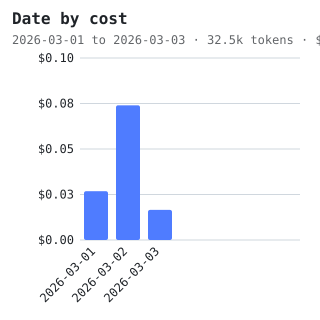
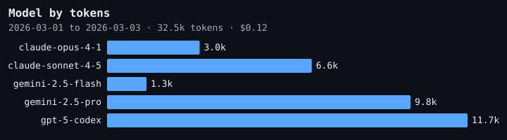

# tokentally

[](https://github.com/OWNER/tokentally/actions/workflows/ci.yml)
[](https://pypi.org/project/tokentally/)
[](https://pypi.org/project/tokentally/)
[](LICENSE)

Count the tokens your AI coding agents burn.

`tokentally` reads the session logs that Claude Code, Codex CLI and Gemini CLI
already write to your home directory, adds up the tokens per day, model,
session or project, and estimates what that usage would cost at API prices.
Nothing leaves your machine.

## Install

```sh
pip install tokentally
```

## Usage

| Command | Shows |
|---|---|
| `daily` (default), `hourly`, `weekly`, `monthly` | Usage per calendar bucket |
| `models`, `sessions`, `projects`, `sources`, `branches` | Usage per dimension |
| `weekdays`, `hours` | When in the week and day you use agents |
| `summary` | Headline numbers, budget progress, daily sparkline |
| `blocks` | Five hour billing windows, live with `--watch` |
| `records` | Raw records as JSON lines |
| `pricing`, `paths`, `config` | The price table, log locations, config file |

```sh
tokentally              # daily report (same as `tokentally daily`)
tokentally models       # one row per model
tokentally monthly --since 2026-01-01
tokentally sessions --sort cost --limit 10
tokentally projects --source claude --format json
```

More examples:

```sh
tokentally summary --since 30d
tokentally daily --since 2w --breakdown model
tokentally models --chart --metric tokens
tokentally monthly --svg monthly.svg --svg-theme dark
tokentally blocks --active --watch
```

See [docs/commands.md](docs/commands.md) for every command and option.

`--svg` writes a standalone chart. These two were rendered from the test
fixtures:




## Where logs are read from

| Agent | Default location | Override |
|---|---|---|
| Claude Code | `~/.claude/projects`, `~/.config/claude/projects` | `CLAUDE_CONFIG_DIR` (comma separated) |
| Codex CLI | `~/.codex/sessions`, `~/.codex/archived_sessions` | `CODEX_HOME` |
| Gemini CLI | `~/.gemini/tmp/*/chats` | |

## Options

| Option | Meaning |
|---|---|
| `--since`, `--until` | Date range, inclusive. Accepts `2026-03-01`, `20260301`, `today`, `yesterday`, `7d` (seven days ago), `2w`. |
| `--source` | `claude`, `codex` or `gemini`. Repeat to pick several. |
| `--model`, `--project` | Case-insensitive substring filters. |
| `--tz` | IANA zone used for day boundaries. Defaults to local time. |
| `--sort` | `key` (default), `cost` or `tokens`. |
| `--limit N` | Show the first N rows. The total row still covers everything. |
| `--breakdown` | Split each row by `model`, `project` or `source`. |
| `--format` | `table` (default), `json` or `csv`. |
| `--chart`, `--metric` | Bar chart of `cost` or `tokens` under the table. |
| `--svg FILE` | Save the chart as SVG; `--svg-theme dark` for a dark background. |

## Privacy

tokentally reads log files and prints numbers. It makes no network requests,
and the only file it writes on its own is the parse cache, which holds token
counts, model names, timestamps, session ids and project paths, never prompt
or response text.

## Speed

Session logs add up to gigabytes. Parsed records are cached per file in
`~/.cache/tokentally/records.json` (or `$XDG_CACHE_HOME`) and reused while a
file's size and modification time are unchanged, so only active sessions are
re-read. Pass `--no-cache` to ignore it, or delete the file to reset it.

## Configuration

Defaults, extra log directories and price overrides live in a TOML file; see
[docs/configuration.md](docs/configuration.md).

## About the cost numbers

Costs are estimates computed from per-model list prices for input, output,
cache writes and cache reads. They are what the same traffic would cost on the
pay-as-you-go API, which is not what a subscription plan bills. Models without a
known price are counted with zero cost and listed on stderr.

Claude Code can write prompt cache entries with a five minute or a one hour
TTL. One hour writes are billed at twice the input rate, so they are priced
separately from the default cache write rate.

## License

MIT, see [LICENSE](LICENSE).
